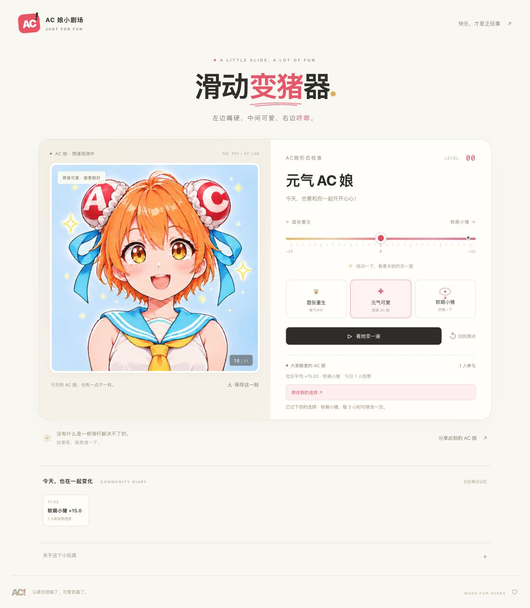

# AC 娘 · 滑动变猪器

左边嚣张重生，中间元气可爱，右边软萌小猪。基于已确认的 AC 娘三锚点图制作的响应式网页小玩具。

## 效果预览

拖动滑杆，在「嚣张重生 → 元气 AC 娘 → 软萌小猪」之间切换，支持自动演示、保存图片和分享当前等级。



### 三种主形态

| −15 · 嚣张重生 | 0 · 元气 AC 娘 | +15 · 软萌小猪 |
| :---: | :---: | :---: |
|  |  |  |
| 又活了，你气不气？ | 今天，也要和你一起开开心心！ | 哼唧。今天的努力到此为止。 |

<details>
<summary>查看手机端效果</summary>

<p></p>

</details>

截图来自本地演示，投票人数与历史记录为演示时的实际测试数据；线上社区数据取决于后端是否接入。

## 本地运行

需要 Node.js **22.13+**（推荐 24 LTS），无需安装依赖。

```sh
npm run dev
```

打开 http://127.0.0.1:5173 。前端、投票 API 和 SQLite 数据库同时启动。首次启动自动创建 `.data/`，包括仅本机可读的 HMAC 密钥文件和投票数据库，不进入 Git。用 `PORT=5174 npm run dev` 更换端口。不要直接双击 HTML，浏览器模块和图片导出需要 HTTP 服务。

```sh
npm test          # 真正 SQLite 上的 API、并发、冷却、限流和时间线测试
npm run check    # JavaScript 语法检查
npm run build    # 生成 dist/ 静态前端
npm run build:site # 生成含同源 API 的 Sites Worker 部署包
```

## 已实现

- `-15 … +15` 共 31 个整数等级，拖动预览精度 0.01；鼠标、触摸、键盘均可操作。
- 7 张关键帧：确认的三种主形态 + 4 张生成的中间形态。Canvas 在相邻关键帧间连续交叉淡化。
- 三个主形态快捷按钮、往返自动演示、暂停、回到原点。
- 导出带阶段名称的 1080 × 1230 PNG，分享当前等级链接（`?level=15`）。
- 显式投票按钮；拖动不提交。每个浏览器一张票，每三小时可改一次，服务器负责校验。
- 社区平均位置、累计与今日人数、每日快照与历史回看。
- 未连接后端时仍可预览和导出，社区区显示未连接；不伪造人数。
- 图片加载失败可重试；减少动态效果偏好、键盘可达、ARIA 状态提示。

### 画面方式与限制

`public/portraits/` 包含 `reborn / minus10 / minus5 / original / plus5 / plus10 / pig.webp`。三种主形态从确认的 `assets/generated/ac-slider-three-anchors-v7.png` 裁出；新增关键帧由内置 imagegen 生成，提示词在本地 `assets/generated/*.prompt.txt`。

**31 级表示滑杆等级，并非 31 张独立绘制原画。** 目前采用 7 张关键帧交叉淡化，不是 RIFE 光流插帧；过渡中可能有轻微叠影。无需运行时 AI、视频解码、付费 API 或加载大模型。原始参考图与生成草稿保留本地，不上传源代码仓库。

## 投票与数据

- 浏览器随机 UUID 保存在 localStorage，**不收集硬件指纹**。清理浏览器数据会丢失该身份；这是轻量趣味投票，不提供强身份认证。
- 服务器使用至少 32 字节密钥对身份与 IP 分别做 HMAC-SHA256，数据库不存原始 IP 或身份。
- 同一 IP 滚动 24 小时最多新增 5 个身份；老身份仍可按三小时冷却改票。
- SQL 条件写入防止并发绕过冷却或重复新增。修改覆盖原票，不累加历史票。
- 社区分数为全部当前票的平均值，保留两位小数；今日人数按北京时间当日更新过的身份计数。
- 每次投票更新当天快照。无投票的日期不会凭空新增数据库行。Cloudflare 独立部署的定时任务在北京时间 23:59 补记当天快照；Worker 也导出 `scheduled` 入口供支持定时触发的宿主使用。Sites 不创建额外自动化任务。
- 时间线最多返回 90 条实际快照。历史行保留当天最后记录到的分数和当时累计人数。

| API | 请求 / 返回 |
| --- | --- |
| `GET /api/score` | score、stage、voterCount、todayVoterCount、positiveCount、negativeCount、neutralCount |
| `POST /api/vote` | JSON `{ fingerprint: browserUUID, position: integer }`；返回 accepted、userPosition、nextVoteAt 与聚合分数 |
| `GET /api/timeline?from=YYYY-MM-DD&to=YYYY-MM-DD` | 按时间排序的 `{ date, score, stage, voterCount }[]` |

`fingerprint` 为兼容原项目的请求字段名，内容实际为随机浏览器 ID。写接口必须有允许的 Origin、JSON Content-Type 和平台提供的 CF-Connecting-IP。开发服务器以真实 socket 地址覆盖客户端同名头。

## 部署

### GitHub Pages

`.github/workflows/pages.yml` 在每次推送 `main` 时自动测试、构建静态前端并部署。仓库的 Settings → Pages → Source 选择 **GitHub Actions**。

所有前端素材均使用相对路径，兼容 `https://用户名.github.io/ac-pig-slider/` 子路径。Pages 不运行 Node 或数据库，因此只托管前端。投票后端未配置时页面明确显示「社区暂未连接」，预览、演示、分享、导出仍可使用。

需要线上投票时，先按下面的 Cloudflare 步骤部署 API，再在仓库 Settings → Secrets and variables → Actions → Variables 中添加 `AC_API_BASE`（仅 HTTPS API origin），重新运行部署即可。不要把任何密钥填入这个公开前端变量。

### Sites（完整前后端）

`.openai/hosting.json` 保存当前项目 ID 和逻辑 D1 绑定 `DB`。`scripts/build-site.mjs` 将静态资源和共享 API 打包为无依赖 Worker；图片以字节嵌入并通过单独 URL 返回。`drizzle/0000_ac_pig.sql` 与 journal 为托管数据库首次迁移。环境变量 `VOTER_HASH_SECRET`（secret）和 `ALLOWED_ORIGINS` 通过 Sites 环境变量设置，绝不能提交进仓库。

### 其他静态平台 + Cloudflare API

`npm run build` 的 `dist/` 可部署到任意静态托管。单独部署后端：

1. 安装或使用官方 Wrangler：`npx wrangler d1 create ac-pig-slider`。
2. 将返回的数据库 ID 填入 `wrangler.jsonc`，把前端地址加入 `ALLOWED_ORIGINS`。
3. `npx wrangler secret put VOTER_HASH_SECRET`，设置随机的至少 32 字节密钥。
4. `npx wrangler d1 migrations apply DB --remote`。
5. `npm run deploy:worker`。
6. `AC_API_BASE=https://你的-api.workers.dev npm run build`，重新部署静态前端。

Wrangler 使用独立数据库，与 Sites D1、开发机 SQLite 互不共享。

## 文件入口

- `index.html` / `src/styles.css`：页面与响应式样式。
- `src/main.js`：Canvas、滑杆、导出、分享、投票、时间线。
- `src/domain.js`：等级、名称、文案、画面映射。
- `server/api.mjs`：Node / Cloudflare 共用的 API 逻辑。
- `server/dev.mjs` / `server/sqlite.mjs`：本地 HTTP 服务与 D1 兼容 SQLite 适配。
- `server/worker.mjs`：独立 Cloudflare Worker 入口。
- `scripts/`：静态构建与托管构建。
- `tests/`：Node 内置测试，无测试框架依赖。

## 致谢与素材

灵感来自 [Lichtspektrum/liang-intensity-calibrator](https://github.com/Lichtspektrum/liang-intensity-calibrator)。本项目重新实现了页面与服务逻辑，没有直接复制该项目的源码或人物素材。AC 娘及相关标识属于各自权利方；生成图片为用户提供参考后的趣味二创，素材授权不由代码许可替代。本项目不是 AcFun 官方产品。
